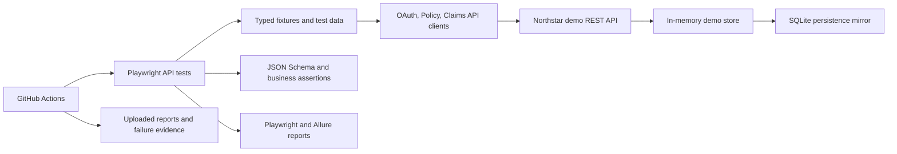

# Northstar Insurance API Quality Gate

An API test automation portfolio project for policy administration and claims workflows. It uses Playwright's `APIRequestContext` with TypeScript, typed API clients, schema and business-rule checks, OAuth 2.0 client credentials, and a deterministic local insurance API used as the test target.

> This repository is an educational portfolio project. The demo API and sample identities are synthetic; they do not represent LTIMindtree, a real insurer, or production security controls.

## What this project demonstrates

- REST resource lifecycle testing with `GET`, `POST`, `PUT`, `PATCH`, and `DELETE`.
- OAuth 2.0 client credentials, scoped bearer tokens, and role authorization.
- JSON Schema contract assertions plus business-level response assertions.
- Positive, negative, boundary, equivalence-partition, and data-driven tests.
- Query parameters, headers, cookies, pagination, rate limits, and error responses.
- Chained policy-to-claim workflows and idempotent claim submission.
- Reusable clients, generated test data, environment validation, and Allure reporting.
- A local demo API for reliable repeatable runs, plus GitHub Actions CI.

## Architecture



See [`docs/architecture.md`](docs/architecture.md), [`docs/test-strategy.md`](docs/test-strategy.md), and the API contract at [`docs/openapi.yaml`](docs/openapi.yaml).

## Quick start

Requirements: Node.js 22 or newer and pnpm 11.25.0.

```bash
npm install --global pnpm@11.25.0
pnpm install --frozen-lockfile
pnpm test
pnpm allure:generate
```

The test configuration starts the local API automatically and generates ephemeral client credentials if none are set. The demo API listens on `127.0.0.1:4180` by default and mirrors synthetic writes to an embedded SQLite file in `.runtime/`; the API itself uses an in-memory store that resets when the server starts. No database service is required. If the port is busy, set `PORT` in `.env` to a free port; the base URL follows it automatically.

To run selected checks:

```bash
pnpm test:api       # Complete API suite
pnpm test:smoke     # Critical policy and claim paths
pnpm typecheck      # TypeScript check
pnpm allure:open    # Open the generated Allure report
```

For a compatible external target, copy `.env.example` to `.env`, set `TEST_ENV=staging` and `BASE_URL`, and provide test client credentials through environment variables or CI secrets. The target must implement the documented demo contract and grant the requested scopes. Never use production credentials or customer records.

## Reports and evidence

Playwright's HTML report is written to `playwright-report/`; Allure results and the generated report are written to `allure-results/` and `allure-report/`. CI uploads these along with Playwright failure artifacts. See [`docs/sample-execution.md`](docs/sample-execution.md) for the verified local run snapshot. This project does not claim performance improvements.

## Folder map

```text
src/config/             Validated environment settings
demo/                   Deterministic local insurance API test target
docs/                   Architecture, test strategy, and roadmap
src/api/                Typed OAuth, policy, and claims API clients
src/data/               Synthetic test data factories
src/database/           Read-only local SQLite validation helper
src/schemas/            JSON Schema contracts
tests/api/              Resource, authorization, boundary, and workflow tests
.github/workflows/      CI quality gate
```

## Future enhancements

1. Add automated OpenAPI document validation and report contract drift by operation.
2. Add token expiry and refresh-token cases if a target contract supports refresh grants.
3. Add a separate k6 performance profile with explicit thresholds and a stable test environment.
4. Run the suite against a disposable staging service and add database checks only through an approved read-only integration.
5. Add a controlled transient-failure profile to evaluate retry and recovery behavior.

These are future items. The current framework has not reported load-test or production-service results.
