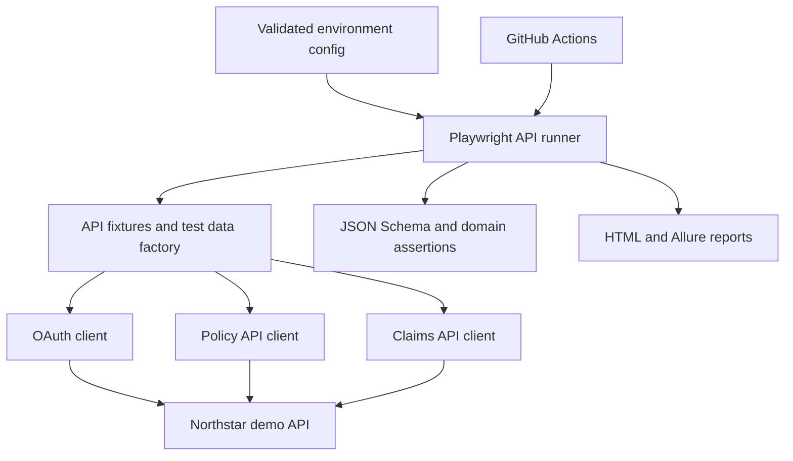

# Architecture

## Business scenario

Northstar Cover is a fictional insurer API. A policyholder creates a policy, reads and updates its details, and files a claim against it. A claims adjuster can review claims. A client-credentials token authorizes service-to-service API access with scopes.

The local API is a controlled test target, not a production-ready insurance product. Its purpose is to make API behavior deterministic so tests can exercise success, validation, authorization, and operational edge cases.

## System view

## Design decisions

| Concern | Choice | Reason / trade-off |
|---|---|---|
| Request engine | Playwright `APIRequestContext` | Reuses the browser automation ecosystem, provides isolated contexts, cookie handling, and convenient CI reporting. |
| Test language | TypeScript | Typed request/response contracts catch mistakes during development while keeping test intent readable. |
| Local target | Node.js built-in HTTP server with embedded SQLite | No separate database service is needed, and API effects can be checked against persisted rows. The trade-off is that this target does not prove behavior against a real insurer backend. |
| API clients | Domain clients for OAuth, policies, and claims | Keep URL construction and common request options reusable without hiding scenario assertions. |
| Contract checks | JSON Schema plus explicit domain assertions | Schemas validate structure and types; test assertions validate business outcomes and status semantics. |
| Data | Unique synthetic factories | Makes tests independent and reduces collision risk under parallel workers. |
| Database validation | Read-only SQL.js test helper against the local SQLite file | Verifies selected API writes at the persistence boundary without adding database access to API clients. Staging database validation remains out of scope. |

## Boundaries

- `config/` selects local, CI, or explicitly configured staging targets and validates required settings.
- `demo/` implements only the behavior needed to exercise the documented API contracts.
- `src/api/` contains thin typed clients; scenario expectations stay in tests.
- `src/data/` provides unique synthetic policyholder and claim data.
- `src/schemas/` holds wire-level response schemas.
- `tests/api/` owns scenario intent, setup, assertions, and regression coverage.
- CI artifacts contain reports and failure evidence; secrets and environment files are excluded from Git.

## Authentication model

The demo exposes an OAuth 2.0 client-credentials token endpoint for test service accounts. Tokens carry scopes for policy reading/writing, claim submission, and claim adjustment. Tests verify missing and invalid credentials, token structure, and insufficient scopes. The API expires tokens after 15 minutes; token expiry is not directly timed in the current short-running suite. Generated local credentials exist only to exercise the synthetic target.

## Quality rules

1. No fixed sleeps; synchronize on API responses and explicit state.
2. Each test creates unique data and must pass independently and in parallel.
3. Validate status, headers, schema, and business meaning when each matters.
4. Avoid assertions about implementation internals unless a separate component test owns that responsibility.
5. Treat rate limits and retries deliberately so the suite itself does not create accidental flakiness.
6. Do not claim production security or database coverage based on the local demo.
